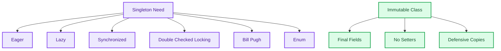

# Java Singleton and Immutable Class Patterns

<p align="center">
  
  
  
</p>

This repository is a Java revision notebook for Singleton implementations and immutable class design. It compares multiple Singleton approaches and includes a simple immutable class example.

## What It Covers

- Eager initialization Singleton.
- Lazy initialization Singleton.
- Synchronized Singleton.
- Double-checked locking Singleton.
- Bill Pugh Singleton pattern.
- Enum-based Singleton.
- Immutable class construction.

## Repository Map

```text
DBConnection.java                                Basic Singleton example
DBConnectionLazyInitialization.java              Lazy Singleton
DBConnectionSynchronized.java                    Synchronized Singleton
DBConnectionSynchronizedDoubleLockingSystem.java Double-checked locking
BillPughDatabaseConnection.java                  Bill Pugh Singleton
DBConnectionEnum.java                            Enum Singleton
MyImmutableClass.java                            Immutable class design
MyImmutableClassMain.java                        Immutable class demo
```

## Pattern Comparison



## Run Locally

```powershell
javac *.java
java MyImmutableClassMain
```

## Revision Notes

- Singleton controls object creation when only one instance should exist.
- Lazy Singleton needs thread-safety care.
- Enum Singleton is concise and serialization-safe.
- Immutable classes should use final fields, no setters, and defensive copies for mutable inputs.

## Interview Talking Points

```text
This repo helps compare Singleton implementations by tradeoff: simplicity, lazy loading,
thread safety, and serialization safety. It also connects object creation patterns with
immutability and safe object design.
```
